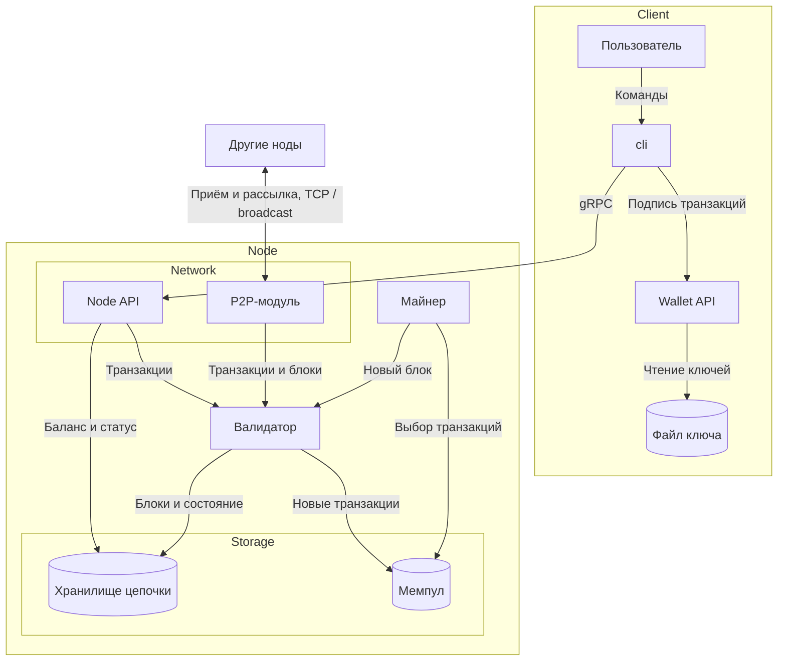
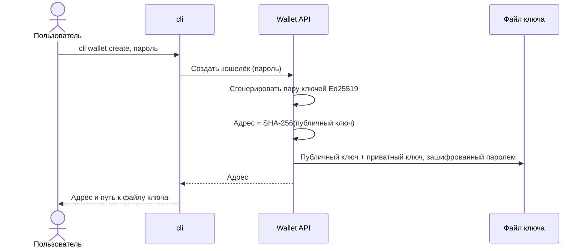
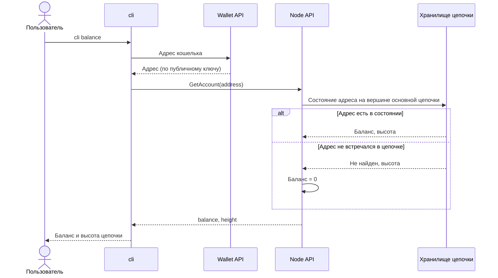
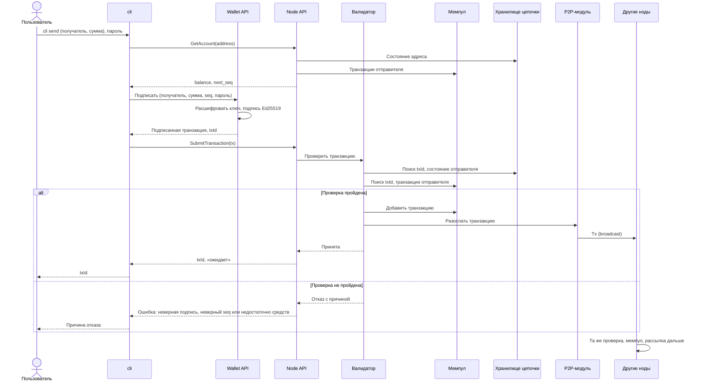
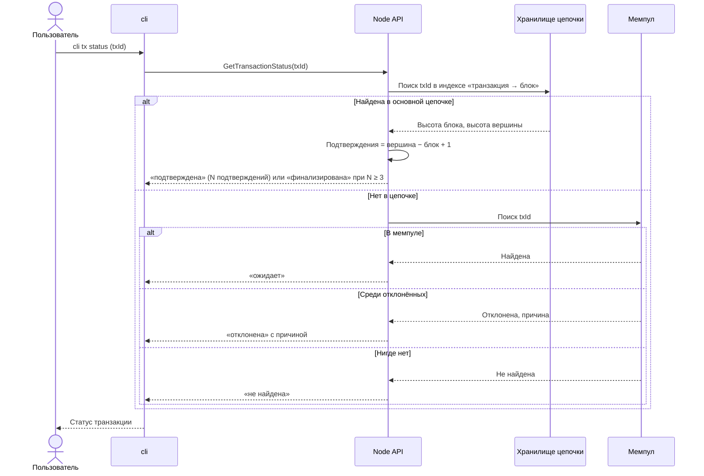
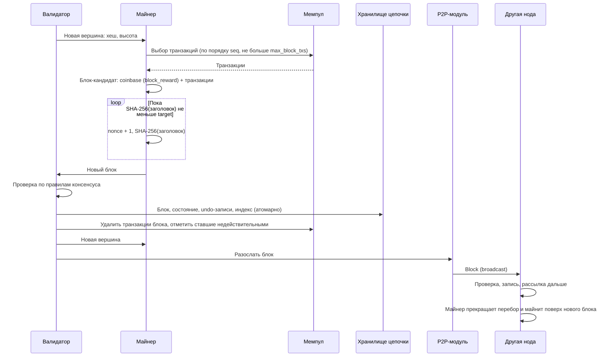
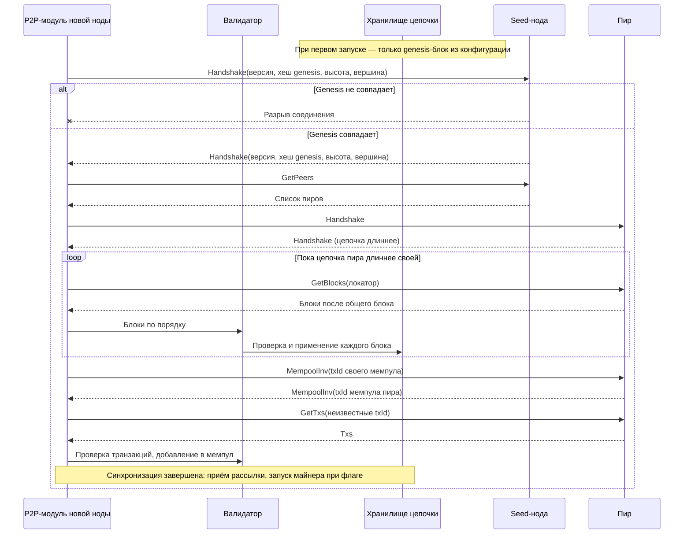
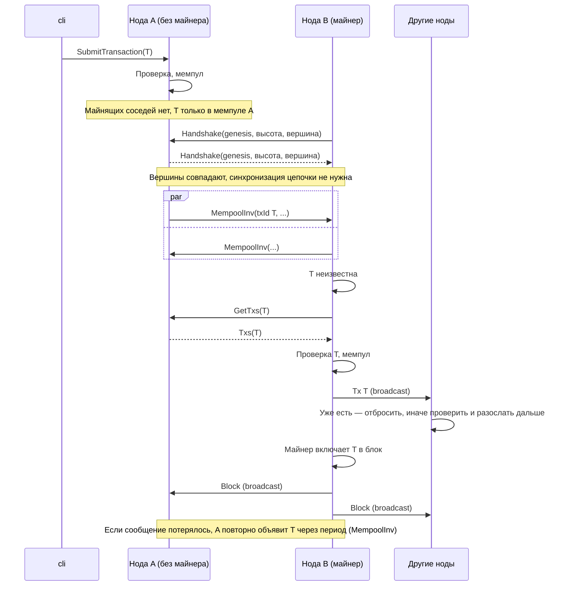
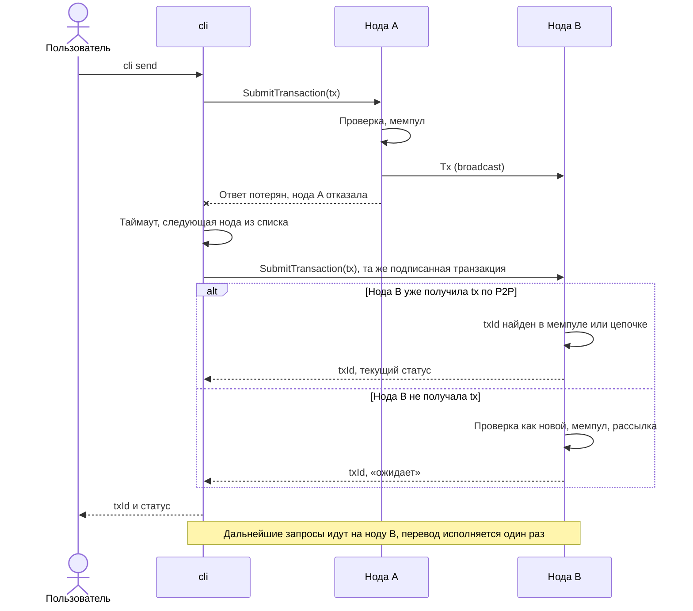
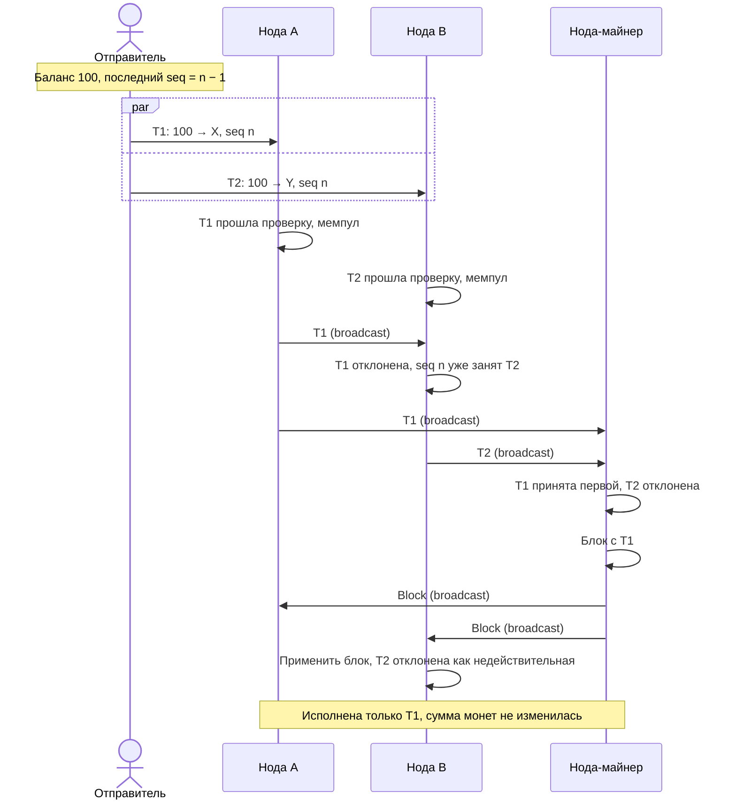

# Техническое решение проекта «pm-wallet»

## Введение
- **Цель проекта:**  
  Создание платежной системы на базе блокчейна, позволяющей безопасно совершать транзакции между участниками распределенной сети  
  - Проект — учебный прототип платёжной системы с условными монетами. Монеты не имеют реальной стоимости, обмена на реальные деньги и внешних платёжных сервисов нет.
  - Ноды блокчейна и алгоритм консенсуса Proof of Work реализуются командой самостоятельно, готовые блокчейн-платформы не используются. Из готовых компонентов берутся только базовые: хэш-алгоритмы, криптографическая библиотека, база данных, сетевые клиенты.
  - Источники средств: начальные балансы заранее подготовленных адресов задаются в genesis-блоке; новые монеты появляются только как награды майнеров; дальше монеты ходят переводами между адресами. Отдельной функции пополнения баланса нет: чтобы получить первые средства, пользователь сообщает свой адрес держателю монет (например, майнеру) и получает перевод.

- **Основания для разработки:**  
  Учебный проект по курсу «Распределенные системы». Изучение p2p-систем

- **Команда:**
  - Анциферов Андрей Сергеевич - Team Lead, DevOps & Frontend Developer
  - m-xim - Backend Developer & DevOps
  - Пискунов Александр Витальевич - Cryptography & Data Engineer, Backend Developer

---

## Глоссарий
| Термин | Определение |
|---------------|-------------|
| Хэш | Результат криптографической хэш-функции (например, SHA-256): строка фиксированной длины. Малейшее изменение входных данных полностью меняет хэш, а восстановить вход по хэшу нельзя. |
| Публичный ключ | Открытая часть пары ключей. Из неё получается адрес пользователя, и по ней проверяется подпись транзакций. |
| Приватный ключ | Секретная часть пары ключей, которой владелец подписывает транзакции. Из публичного ключа её вычислить невозможно. |
| Нода | Узел сети, который хранит копию блокчейна, проверяет транзакции и блоки и обменивается ими с другими нодами. |
| Кошелёк | Компонент программы, владеющий связкой ключей и выполняющий подписывание транзакций. |
| Клиент | Интерфейс, предоставляющий пользовательсий доступ к функциям кошелька |
| Транзакция | Подписанная запись о действии в сети, содержащая отправителя, получателя, сумму и цифровую подпись. |
| Целевой хэш | Хэш, по которому можно определить, подходит ли новый хэш для блока, или нет. Новый для каждого блока |
| Nonce | Специально подобранное уникальное число, которое позволяет сгенерировать хэш, подходящий по условиям целевого хэша |
| Блок | Структура данных, которая объединяет группу транзакций. Заголовок блока содержит хэш предыдущего блока, временную метку и nonce. |
| Блокчейн | Цепочка блоков, где каждый блок ссылается на хэш предыдущего. |
| Майнер | Участник сети, который собирает транзакции в блок и решает задачу Proof of Work, чтобы добавить его в цепочку, за что получает награду. |
| Мемпул (mempool) | Хранилище проверенных, но ещё не включённых в блок транзакций на каждой ноде. Отсюда майнеры берут транзакции для новых блоков. |

---

## Функциональные требования
Система должна предоставлять следующие функции:
- Создание кошелька
- Просмотр баланса
- Осуществление транзакций
- Просмотр статуса транзакции
- Достижение консенсуса через Proof of Work

---

## Нефункциональные требования
- Масштабируемость: в любой момент в системе может появиться новая нода и стать полноценным участником сети
- Доступность: пока работает хотя бы одна майнящая нода, сеть принимает транзакции и создаёт блоки.
- Надёжность: транзакция не исполняется дважды, в том числе при повторной отправке. Статусы «подтверждена» и «финализирована» отражают текущую основную цепочку и могут быть пересмотрены при её смене: транзакция из отброшенного блока не теряется, а возвращается в мемпул или отклоняется, если стала недействительной (см. «Статусы транзакции»). Суммарное количество монет в цепочке равно сумме начальных балансов из genesis-блока и наград майнеров.
- Асинхронность: общих часов и общей памяти нет, порядок задаёт цепочка блоков.
- Согласованность: после восстановления связи ноды сходятся к одной цепочке (eventual consistency). Транзакция считается финализированной после 3 подтверждений. Это выбранный порог уверенности, а не гарантия необратимости: вероятность отката убывает с каждым следующим блоком, но зависит от доли хешрейта майнеров конкурирующей ветви и от условий связи; при разделении сети откат финализированной транзакции возможен и без нечестных майнеров.
- Безопасность: транзакция подписана Ed25519, подпись покрывает все поля. Отправитель определяется только подписью. Приватный ключ не передаётся по сети и не логируется.

---

## Пользовательские сценарии
1. Создание кошелька
   1. Пользователь через интерфейс запрашивает создание кошелька.
   2. Клиент генерирует пару ключей и вычисляет из публичного ключа адрес.
   4. Результат: у пользователя есть адрес и файл ключа.
2. Просмотр баланса
   1. Пользователь запрашивает баланс своего адреса.
   2. Клиент спрашивает у ноды баланс этого адреса.
   3. Нода возвращает баланс и высоту цепи, на которой он посчитан, клиент показывает их пользователю.
   4. Альтернатива: если адрес ещё не встречался в цепочке, баланс нулевой.
3. Осуществление транзакции (у пользователя есть кошелёк, на балансе достаточно средств, адрес получателя известен)
   1. Пользователь указывает адрес получателя и сумму.
   2. Клиент формирует транзакцию и подписывает её приватным ключом.
   3. Клиент отправляет транзакцию на ноду.
   4. Нода проверяет подпись и достаточность средств.
   5. Если проверка пройдена, нода сохраняет транзакцию в мемпул, рассылает её другим нодам и возвращает идентификатор транзакции.
   6. Дальше транзакцию включает в блок майнер (сценарий 5).
   7. Альтернатива, проверка не пройдена: нода отвечает отказом с причиной. Транзакция не сохраняется и не рассылается.
   8. Альтернатива, ответа нет: клиент повторяет ту же подписанную транзакцию. Нода находит её по идентификатору и возвращает текущий статус, перевод исполняется один раз.
3. Осуществление транзакции (у пользователя есть кошелёк, на балансе достаточно средств, адрес получателя известен)
   1. Пользователь указывает адрес получателя и сумму.
   2. Клиент формирует транзакцию и подписывает её приватным ключом.
   3. Клиент отправляет транзакцию на ноду.
   4. Нода проверяет подпись и достаточность средств.
   5. Если проверка пройдена, нода сохраняет транзакцию в мемпул, рассылает её другим нодам и возвращает идентификатор транзакции.
   6. Дальше транзакцию включает в блок майнер (сценарий 5).
   7. Альтернатива, проверка не пройдена: нода отвечает отказом с причиной. Транзакция не сохраняется и не рассылается.
   8. Альтернатива, ответа нет: клиент повторяет ту же подписанную транзакцию. Нода находит её по идентификатору и возвращает текущий статус, перевод исполняется один раз.
4. Просмотр статуса транзакции
   1. Пользователь указывает идентификатор транзакции.
   2. Клиент запрашивает статус у ноды.
   3. Пользователь видит один из статусов: «ожидает» (в мемпуле), «подтверждена» (в блоке, с числом подтверждений), «финализирована» (набрано 3 подтверждения), «не найдена».
   4. Альтернатива: если после смены цепочки (сценарий 5) блок с транзакцией отброшен, статус снова «ожидает». Если транзакция стала недействительной, нода сообщает, что она отклонена.
5. Достижение консенсуса через Proof of Work (участвуют ноды-майнеры и остальные ноды)
   1. Майнер берёт из мемпула проверенные транзакции и добавляет к ним транзакцию с наградой за блок.
   2. Майнер подбирает число в заголовке блока, пока хеш заголовка не удовлетворит условию сложности.
   3. Найдя решение, майнер добавляет блок в свою цепочку и рассылает его другим нодам.
   4. Каждая нода проверяет полученный блок до добавления: условие сложности, ссылку на предыдущий блок, корректность каждой транзакции.
   5. Если блок корректен, нода добавляет его в цепочку и убирает его транзакции из мемпула. Если нет, отбрасывает.
   6. Если майнер получил корректный блок той же высоты раньше, чем нашёл свой, он прекращает попытку и майнит поверх полученного блока.
   7. Альтернатива, форк: два майнера почти одновременно нашли блок одной высоты, и ноды приняли разные блоки. Когда в одной из ветвей появляется следующий блок, ноды на другой ветви переходят на цепочку с наибольшей суммарной работой. Транзакции отброшенных блоков, не вошедшие в новую цепочку, возвращаются в мемпул.
   8. Результат: все ноды сходятся к одной цепочке, и каждая транзакция в ней исполнена не более одного раза.

---

##  Архитектура системы
Основные компоненты:
 
1. **Client** — сторона пользователя:
   - **cli** — клиентское приложение командной строки, через которое пользователь работает с системой. Для подписи транзакций обращается к Wallet API, с нодой общается по gRPC через Node API. Знает адреса нескольких нод и при недоступности одной переключается на другую.
   - **Wallet API** — внутренний модуль клиента для работы с ключами: генерирует пару ключей, вычисляет адрес, подписывает транзакции. Единственный компонент, который читает файл ключа; приватный ключ не покидает устройство пользователя.
   - **Файл ключа** — локальный файл на устройстве пользователя, в котором приватный ключ хранится в зашифрованном паролем виде.
2. **Node** — процесс ноды, состоит из трёх частей:
   - **Network** — сетевой слой ноды:
     - **Node API** — gRPC-интерфейс ноды для клиентов. Транзакции передаёт валидатору, баланс и статус транзакций читает из хранилища цепочки (статус «ожидает» — из мемпула).
     - **P2P-модуль** — обмен с другими нодами по TCP в обе стороны в режиме широковещательной рассылки (broadcast): рассылает свои транзакции и блоки всем соседям и так же получает их от других нод. Также отвечает за знакомство (handshake), обмен списками пиров, синхронизацию цепочки и мемпула. Полученные данные передаёт валидатору.
   - **Майнер** — включается флагом при запуске ноды. Выбирает транзакции из мемпула, собирает блок-кандидат с coinbase-транзакцией, перебирает nonce и передаёт найденный блок валидатору.
   - **Валидатор** — проверяет транзакции и блоки по правилам консенсуса. Одни и те же правила применяются к данным от клиента, от других нод и к блокам собственного майнера. Принятые транзакции кладёт в мемпул, принятые блоки и новое состояние записывает в хранилище цепочки.
   - **Storage** — данные ноды:
     - **Хранилище цепочки** — встроенная БД ноды: блоки (включая боковые ветви), индекс «транзакция → блок», текущее состояние адресов (баланс и последний seq), undo-записи для отката блоков при реорганизации.
     - **Мемпул** — проверенные, но ещё не включённые в блок транзакции, хранится в памяти ноды.
3. **Другие ноды** — участники сети с такой же структурой. Среди них seed-ноды, записанные в конфигурации по умолчанию: через них новая нода получает список пиров. Особых прав в консенсусе у seed-нод нет.
4. **Genesis-блок** — первый блок с начальными балансами, зашит в конфигурацию и одинаков у всех нод. Нода с другим genesis-блоком считается участником другой сети, соединение с ней разрывается.

### Правила консенсуса

Правила одинаковы для всех нод и реализуются одним модулем, который используют и майнер при сборке блока, и валидатор при проверке блоков от пиров и от собственного майнера. Параметры консенсуса записаны в genesis-блоке и входят в его хеш, поэтому нода с другими параметрами относится к другой сети и отключается при handshake.

| Параметр | Значение | Смысл |
|----------|----------|-------|
| `difficulty_bits` | 20 | Сложность. Целевой хеш `target = 2^(256 − difficulty_bits)` фиксирован на всё время жизни сети и не пересчитывается |
| `block_reward` | 50 монет | Награда майнеру за блок. Комиссий нет |
| `max_block_txs` | 100 | Максимальное число обычных транзакций в блоке, coinbase-транзакция не считается |

Суммы в транзакциях — целые числа монет, дробных единиц нет.

**Заголовок блока:** `version`, `height`, `prev_hash`, `tx_root`, `timestamp`, `difficulty_bits`, `nonce`. Хеш блока — SHA-256 от сериализованного заголовка. `tx_root` — SHA-256 от конкатенации txId всех транзакций блока по порядку, начиная с coinbase.

**Coinbase-транзакция:** без отправителя и подписи, содержит адрес майнера, сумму и высоту блока. Высота делает txId coinbase-транзакции уникальным для каждого блока.

**Блок корректен, если выполнены все условия:**
1. Родительский блок `prev_hash` известен и корректен, `height` равен высоте родителя плюс 1.
2. `difficulty_bits` равен значению из genesis-блока, а хеш заголовка как 256-битное число меньше `target`, то есть первые `difficulty_bits` бит хеша нулевые.
3. `timestamp` не меньше временной метки родителя. Метка справочная: сложность от неё не зависит, а с локальными часами ноды она не сравнивается, потому что общих часов в сети нет и правило должно давать одинаковый результат на всех нодах. Майнер ставит метку max(локальное время, метка родителя).
4. Первая транзакция — coinbase-транзакция с суммой ровно `block_reward` и высотой этого блока; других coinbase-транзакций в блоке нет.
5. Обычных транзакций не больше `max_block_txs`.
6. `tx_root` совпадает с хешем списка txId транзакций блока.
7. Все обычные транзакции корректны при последовательном применении к состоянию после родительского блока.

**Транзакция корректна относительно состояния, если:**
1. Подпись Ed25519 под всеми полями (публичный ключ отправителя, адрес получателя, сумма, seq) верна для публичного ключа отправителя. Адрес отправителя — SHA-256 от его публичного ключа.
2. Сумма — целое число больше 0, адрес получателя имеет корректный формат.
3. seq равен последнему seq отправителя плюс 1.
4. Баланс отправителя не меньше суммы.

В мемпул транзакция принимается по тем же условиям относительно состояния вершины основной цепочки с учётом транзакций отправителя, уже находящихся в мемпуле.

**Выбор основной цепочки:** target фиксирован, поэтому работа всех блоков одинакова, и суммарная работа ветви равна её длине. Основная цепочка — самая длинная корректная цепочка от genesis-блока. При равной длине нода остаётся на ветви, вершину которой получила первой, и переключается только на строго более длинную ветвь. Глубина реорганизации не ограничена.

### Консенсус Proof of Work и выбор цепочки

- **Проблема:** в сети нет координатора, ноды получают транзакции и блоки в разном порядке, а договориться нужно об одной истории. Два майнера могут почти одновременно найти блок одной высоты, а при разделении сети каждая часть строит свою ветвь.
- **Решение:** блок добавляет майнер, нашедший nonce, при котором хеш заголовка меньше фиксированного целевого хеша. Все ноды проверяют блоки по одним и тем же правилам (см. «Правила консенсуса») и выбирают самую длинную корректную цепочку. Блоки других ветвей хранятся как боковые ветви; когда боковая ветвь становится длиннее основной, нода выполняет реорганизацию: откатывает блоки до общего предка по undo-записям и применяет блоки новой ветви.
- **Гарантия:** правила проверки детерминированы и не зависят от локальных часов, поэтому все ноды одинаково оценивают корректность и длину каждой ветви. Получив одни и те же блоки, ноды выбирают одну и ту же цепочку (eventual consistency); ничья между ветвями равной длины разрешается, как только одна из них получает следующий блок.
- **Компромиссы:** подтверждение вероятностное: любая транзакция в блоке, в том числе со статусом «финализирована», может быть отменена реорганизацией (см. «Статусы транзакции»). Фиксированная сложность не подстраивается под число майнеров: при росте хешрейта блоки появляются чаще и форков больше, при падении — реже. Майнер или группа майнеров с бо́льшим хешрейтом, чем у остальной сети, может построить более длинную ветвь и отменить чужие транзакции; для учебной сети это допустимо. Подбор nonce расходует вычислительные ресурсы.

### Статусы транзакции

Нода вычисляет статус транзакции в момент запроса по своей текущей основной цепочке и мемпулу:

| Статус | Условие |
|--------|---------|
| «ожидает» | Транзакция в мемпуле ноды, в основной цепочке её нет |
| «подтверждена» | Транзакция в блоке основной цепочки, число подтверждений k = высота вершины − высота блока + 1 меньше 3 |
| «финализирована» | Транзакция в блоке основной цепочки, k ≥ 3 |
| «отклонена» | Транзакция удалена из мемпула как недействительная относительно основной цепочки (конфликт seq, недостаточно средств); нода помнит её txId и причину |
| «не найдена» | Нода не знает такую транзакцию |

- Порог в 3 подтверждения — выбранный для учебной сети уровень уверенности, а не гарантия необратимости. Правила выбора цепочки не запрещают реорганизацию любой глубины, поэтому статус любой транзакции из блока, в том числе «финализирована», может быть пересмотрен.
- Если при реорганизации транзакция из отброшенного блока не вошла в новую ветвь, она получает статус «ожидает», когда остаётся действительной, или «отклонена», когда в новой ветви исполнена конфликтующая транзакция с тем же seq или отправителю не хватает средств.
- Вероятность отката транзакции с k подтверждениями зависит от доли хешрейта майнеров, строящих конкурирующую ветвь, и от условий связи: задержки распространения блоков относительно времени нахождения блока и разделения сети. В связной сети с малыми задержками форки разрешаются за один-два блока, и откат после 3 подтверждений маловероятен. При разделении сети, если майнеры работают в обеих частях, в каждой части могут накопиться 3 и более подтверждений для конфликтующих переводов; после восстановления связи транзакции более короткой ветви откатываются даже без нечестных майнеров.
- Отклонённая транзакция в мемпул автоматически не возвращается. Отправитель может отправить её повторно, и она будет принята, если снова стала действительной.

### Однократное исполнение транзакций

- **Проблема:** клиент повторяет запрос, если не получил ответ; одна и та же транзакция приходит на ноду от клиента и от нескольких пиров; подписанную транзакцию может повторно отправить кто угодно (replay). Отправитель может попытаться потратить одни и те же средства дважды, отправив разные транзакции на разные ноды.
- **Решение:** в состоянии каждого адреса хранится последний seq. Транзакция содержит seq отправителя и действительна, только если её seq следует сразу за последним seq отправителя с учётом его транзакций в мемпуле. Идентификатор транзакции (txId) — хеш её полей вместе с подписью. По txId нода находит транзакцию в мемпуле или в индексе «транзакция → блок» и не обрабатывает её повторно. Две разные транзакции с одним seq конфликтуют: нода принимает первую полученную, а в цепочку попадает только одна из них.
- **Гарантия:** каждая транзакция исполняется не более одного раза; повторная отправка возвращает статус уже существующей транзакции.
- **Компромиссы:** транзакции одного отправителя исполняются строго по порядку: если транзакция с seq = n отклонена, транзакции с бо́льшим seq не пройдут проверку, пока не будет отправлена замена. При повторе клиент обязан отправлять ту же подписанную транзакцию, а не формировать новую.

### Распространение данных в P2P-сети

- **Проблема:** центрального сервера нет, ноды подключаются и отключаются в любой момент, сообщения между нодами теряются и дублируются. Однократной рассылки недостаточно: транзакция, принятая до подключения пира или потерянная при рассылке, может остаться только в мемпуле немайнящей ноды и не попасть в блок.
- **Решение:**
  - Знакомство: новая нода получает список пиров от seed-нод и затем обменивается списками пиров с соседями. При handshake ноды сверяют версию протокола и хеш genesis-блока и сообщают высоту и хеш вершины своей цепочки.
  - Рассылка: новую принятую транзакцию или блок нода рассылает всем соседям (broadcast).
  - Синхронизация цепочки: нода запрашивает недостающие блоки при подключении к пиру с более длинной цепочкой, при получении блока с неизвестным родителем и при получении heartbeat от соседа, чья цепочка длиннее.
  - Синхронизация мемпула: после handshake и синхронизации цепочки ноды обмениваются списками txId своих мемпулов (`MempoolInv`) и запрашивают транзакции, которых у них нет (`GetTxs`). Кроме того, каждая нода периодически (например, раз в 30 с) повторно объявляет соседям txId транзакций своего мемпула. Так транзакция доходит до пира, подключившегося позже или пропустившего рассылку, а мемпул ноды, хранящийся в памяти, восстанавливается после её перезапуска. Полученные транзакции валидатор проверяет как обычно.
  - Дедупликация: повторный эффект подавляет получатель. Транзакцию, txId которой уже есть в его мемпуле или в индексе цепочки, и уже известный блок он не проверяет и не рассылает повторно. Отправитель не отказывается передавать транзакцию из-за того, что уже видел её: объявления содержат все ожидающие транзакции, а на `GetTxs` нода всегда отвечает, поэтому пир, ещё не получивший транзакцию, может её запросить. Чтобы не слать одно и то же одному пиру, нода помнит txId, уже известные каждому соединению; этот набор сбрасывается при переподключении.
- **Гарантия:** пока граф соединений связен, каждый блок основной цепочки и каждая транзакция, остающаяся в мемпуле хотя бы одной ноды, доходят до всех нод, в том числе до майнеров; повторная доставка не приводит к повторной обработке.
- **Компромиссы:** широковещательная рассылка создаёт трафик, пропорциональный числу соединений, а задержка распространения растёт с диаметром сети. Периодические объявления добавляют трафик, пропорциональный размеру мемпула и числу соседей; поэтому в объявлениях передаются только txId, а сами транзакции — по запросу. Транзакция, пропустившая рассылку, доходит с задержкой до одного периода объявления. Если единственная нода, знавшая транзакцию, перезапустилась до её распространения, транзакция теряется: клиент увидит статус «не найдена» и может повторно отправить ту же подписанную транзакцию. Для первого подключения нужна хотя бы одна доступная seed-нода или вручную указанный адрес пира.

| Сообщение | Назначение |
|-----------|------------|
| `Handshake` | Версия протокола, хеш genesis-блока, высота и хеш вершины цепочки |
| `GetPeers` / `Peers` | Обмен списками адресов пиров |
| `Tx` | Рассылка новой транзакции |
| `Block` | Рассылка нового блока |
| `GetBlocks` / `Blocks` | Запрос блоков по локатору и ответ пачкой блоков |
| `MempoolInv` | Список txId транзакций мемпула: после подключения и периодически |
| `GetTxs` / `Txs` | Запрос транзакций по txId и ответ |
| `Ping` / `Pong` | Heartbeat с высотой и хешем вершины цепочки |

### Обработка частичных отказов

- **Проблема:** нода или соединение могут отказать молча, и медленную ноду нужно отличать от отказавшей. Сеть может разделиться на части.
- **Решение:** cli ждёт ответа ноды с таймаутом и при его истечении переключается на следующую ноду из списка, повторно отправляя ту же подписанную транзакцию. Ноды проверяют соседей периодическими heartbeat-сообщениями, отключают неотвечающих, подключаются к другим известным пирам и позже пробуют переподключиться. При разделении сети каждая часть продолжает принимать транзакции и, если в ней есть майнер, создавать блоки; после восстановления связи ноды синхронизируют цепочку и мемпул и переходят на самую длинную цепочку. Блок записывается в хранилище атомарно вместе с состоянием, undo-записями и индексом, поэтому после аварийного перезапуска нода продолжает с последнего целиком записанного блока.
- **Гарантия:** отказ отдельных нод не останавливает сеть, пока работает хотя бы одна майнящая нода; после восстановления связи ноды сходятся к одной цепочке.
- **Компромиссы:** доступность выбрана в ущерб строгой согласованности: во время разделения части сети расходятся, и подтверждения, в том числе со статусом «финализирована», в части, построившей более короткую ветвь, будут отменены. Короткий таймаут приводит к лишним переключениям клиента, длинный замедляет реакцию на отказ.

---

## Технические сценарии

### Сценарий: создание кошелька

1. Пользователь выполняет команду `cli wallet create` и вводит пароль.
2. cli передаёт запрос в Wallet API.
3. Wallet API генерирует пару ключей Ed25519 и вычисляет адрес как хеш SHA-256 от публичного ключа.
4. Wallet API шифрует приватный ключ ключом, выведенным из пароля, и записывает в файл ключа публичный ключ и зашифрованный приватный ключ.
5. cli показывает пользователю адрес и путь к файлу ключа. Обращения к ноде нет: адрес появится в состоянии цепочки, когда на него придёт первый перевод.

### Сценарий: просмотр баланса

1. Пользователь выполняет команду `cli balance`.
2. cli получает адрес у Wallet API: адрес вычисляется по публичному ключу из файла ключа, пароль не нужен.
3. cli отправляет в Node API gRPC-запрос `GetAccount(address)`.
4. Node API читает из хранилища цепочки состояние адреса на вершине основной цепочки. Если адрес ещё не встречался в цепочке, баланс равен 0.
5. Node API возвращает баланс и высоту цепочки, на которой он посчитан; cli показывает их пользователю.
6. Если нода не ответила за таймаут, cli повторяет запрос на следующей ноде из списка.

### Сценарий: отправка транзакции

1. Пользователь выполняет команду `cli send` с адресом получателя и суммой и вводит пароль.
2. cli запрашивает у Node API `GetAccount(address)` своего адреса. Нода возвращает баланс и следующий seq: последний seq адреса в цепочке плюс число транзакций отправителя в мемпуле плюс 1.
3. cli передаёт в Wallet API получателя, сумму, seq и пароль. Wallet API расшифровывает приватный ключ и подписывает Ed25519 все поля транзакции: публичный ключ отправителя, адрес получателя, сумму, seq. txId — хеш полей транзакции вместе с подписью.
4. cli отправляет подписанную транзакцию в Node API запросом `SubmitTransaction(tx)`.
5. Node API передаёт транзакцию валидатору. Если txId уже есть в мемпуле или в индексе цепочки, валидатор не проверяет её повторно, и нода возвращает текущий статус.
6. Валидатор проверяет подпись, вычисляет адрес отправителя по публичному ключу, проверяет, что сумма положительна, seq равен следующему seq отправителя и баланса хватает с учётом его транзакций в мемпуле.
7. Если проверка пройдена, валидатор кладёт транзакцию в мемпул, P2P-модуль рассылает её соседям, Node API возвращает txId и статус «ожидает».
8. Другие ноды выполняют ту же проверку, кладут транзакцию в свой мемпул и рассылают дальше. Уже виденную транзакцию нода не обрабатывает и не пересылает.
9. Если проверка не пройдена, Node API возвращает отказ с причиной (неверная подпись, неверный seq, недостаточно средств). Транзакция не сохраняется и не рассылается.

### Сценарий: просмотр статуса транзакции

1. Пользователь выполняет команду `cli tx status` с идентификатором транзакции.
2. cli отправляет в Node API запрос `GetTransactionStatus(txId)`.
3. Node API ищет txId в индексе «транзакция → блок» основной цепочки. Если транзакция найдена, число подтверждений равно высоте вершины минус высота блока плюс 1. При 3 и более подтверждениях статус «финализирована» — это порог уверенности, а не гарантия необратимости; иначе «подтверждена» с числом подтверждений.
4. Если в цепочке транзакции нет, Node API ищет её в мемпуле: статус «ожидает».
5. Мемпул также помнит идентификаторы транзакций, удалённых как недействительные (например, после реорганизации или из-за конфликта seq), с причиной: статус «отклонена».
6. Если транзакция нигде не найдена, статус «не найдена».
7. Статус вычисляется заново при каждом запросе и может измениться в обратную сторону, в том числе у финализированной транзакции: при реорганизации блок с транзакцией откатывается, запись индекса удаляется, а транзакция возвращается в мемпул со статусом «ожидает» или отклоняется (см. «Статусы транзакции» и сценарий «Форк и реорганизация цепочки»).

### Сценарий: майнинг и распространение блока

1. Нода запущена с флагом майнинга. Валидатор сообщает майнеру новую вершину основной цепочки: хеш и высоту.
2. Майнер выбирает из мемпула транзакции в порядке поступления, соблюдая порядок seq каждого отправителя, но не больше `max_block_txs` = 100.
3. Майнер добавляет первой coinbase-транзакцию на свой адрес с наградой `block_reward` = 50 и высотой блока и формирует заголовок: `version`, `height`, `prev_hash` (хеш вершины), `tx_root`, `timestamp` = max(локальное время, метка родителя), `difficulty_bits` из genesis-блока, `nonce`.
4. Майнер перебирает nonce, пока хеш SHA-256 заголовка не станет меньше `target = 2^(256 − difficulty_bits)`, и передаёт блок валидатору.
5. Валидатор проверяет блок по правилам из раздела «Правила консенсуса» — тем же, по которым проверяются блоки от других нод.
6. Валидатор атомарно записывает в хранилище цепочки блок, новое состояние адресов, undo-записи и записи индекса «транзакция → блок». Из мемпула удаляются транзакции блока и транзакции, ставшие недействительными; последние помечаются отклонёнными.
7. P2P-модуль рассылает блок соседям. Другие ноды проверяют блок, записывают его и рассылают дальше. Их майнеры прекращают перебор и начинают новый блок поверх полученного.

### Сценарий: форк и реорганизация цепочки

1. Два майнера почти одновременно находят блоки X1 и Y1 одной высоты. Часть нод первым получает X1, часть — Y1. Ветви равной длины, поэтому каждая нода оставляет в основной цепочке первый полученный блок, а второй после проверки заголовка (родитель, высота, `difficulty_bits`, хеш меньше target) сохраняет как боковую ветвь, не применяя его к состоянию.
2. Майнеры продолжают майнить поверх своей ветви. Майнер ветви Y находит блок Y2 и рассылает его.
3. Нода на ветви X получает Y2. Если родитель Y2 неизвестен, нода запрашивает недостающие блоки у отправителя.
4. Валидатор сравнивает длину ветвей: target фиксирован, поэтому работа ветви равна числу её блоков. Ветвь Y длиннее, поэтому нода выполняет реорганизацию: находит общего предка, откатывает X1 по undo-записям (состояние адресов и индекс транзакций), затем проверяет и применяет Y1 и Y2. Реорганизация записывается атомарно. Если блок новой ветви не проходит проверку, ветвь отбрасывается, и нода остаётся на прежней цепочке.
5. Транзакции из X1, не вошедшие в Y1 и Y2, повторно проверяются и возвращаются в мемпул; транзакции, ставшие недействительными (например, конфликт seq), помечаются отклонёнными. Coinbase-транзакция X1 отбрасывается.
6. Майнер ноды прекращает перебор и майнит поверх Y2.
7. Так же нода действует после разделения сети: при восстановлении связи ноды обмениваются при handshake высотой и хешем вершины, нода с более короткой цепочкой запрашивает блоки более длинной ветви и выполняет реорганизацию. Глубина отката не ограничена: если за время разделения в проигравшей ветви накопилось 3 и более блоков, откатываются и транзакции со статусом «финализирована» — они получают статус «ожидает» или «отклонена» (см. «Статусы транзакции»). Затем ноды обмениваются мемпулами, и вернувшиеся в мемпул транзакции доходят до майнеров другой части сети.

### Сценарий: подключение новой ноды и синхронизация цепочки

1. Нода запускается с конфигурацией: genesis-блок, адреса seed-нод, флаг майнинга. При первом запуске хранилище цепочки содержит только genesis-блок, при перезапуске — ранее сохранённую цепочку.
2. P2P-модуль подключается к seed-ноде по TCP и выполняет handshake: версия протокола, хеш genesis-блока, высота и хеш вершины цепочки. Если хеши genesis-блоков не совпадают (в том числе из-за других параметров консенсуса), соединение разрывается.
3. Нода запрашивает у seed-ноды список пиров (`GetPeers`) и подключается к нескольким из них, выполняя handshake с каждым.
4. Если у пира цепочка длиннее, нода отправляет ему `GetBlocks` с локатором — списком хешей своей цепочки, по которому пир находит последний общий блок. Пир возвращает следующие блоки пачкой.
5. Валидатор проверяет и применяет каждый блок по правилам консенсуса. Запросы повторяются, пока цепочка ноды не догонит пира.
6. Если пир отказал во время синхронизации, нода продолжает её с другим пиром начиная с последнего применённого блока.
7. После синхронизации цепочки нода обменивается с пирами списками txId мемпулов и получает ожидающие транзакции, которых у неё нет (сценарий «Передача ожидающих транзакций пиру»).
8. Дальше нода принимает транзакции и блоки из рассылки и, если указан флаг, запускает майнер.

### Сценарий: передача ожидающих транзакций пиру

1. Немайнящая нода A принимает от клиента транзакцию T и кладёт её в мемпул. Майнящих соседей у A в этот момент нет (или рассылка `Tx` потерялась), поэтому T есть только в мемпуле A.
2. К A подключается майнящая нода B. При handshake genesis-блоки совпадают, высоты и вершины одинаковы, синхронизация цепочки не нужна.
3. A и B отправляют друг другу `MempoolInv` со списками txId своих мемпулов.
4. B находит в списке A неизвестный ей txId T и отправляет `GetTxs(T)`; A отвечает `Txs(T)`. Транзакции, которые у B уже есть в мемпуле или в цепочке, не запрашиваются.
5. Валидатор B проверяет T как обычную транзакцию, кладёт её в мемпул и рассылает соседям. Соседи, у которых T уже есть, её отбрасывают.
6. Майнер B включает T в следующий блок. Блок расходится по сети, и на всех нодах T получает статус «подтверждена».
7. Если `MempoolInv` или `Txs` потерялись, A повторно объявит T при следующем периодическом объявлении (например, через 30 с). Это повторяется, пока T остаётся в мемпуле A: пока не попадёт в блок или не станет недействительной.
8. Так же мемпул восстанавливается после переподключения пира и после перезапуска ноды, у которой мемпул в памяти был потерян.

### Сценарий: недоступность ноды и повторная отправка транзакции

1. cli отправляет подписанную транзакцию на ноду A. Нода A принимает её и рассылает по сети, но ответ до клиента не доходит: нода упала или оборвалась связь.
2. cli не получает ответа за таймаут и отправляет ту же подписанную транзакцию (тот же txId) на ноду B из своего списка. Транзакция не переподписывается и не получает новый seq.
3. Если нода B уже получила транзакцию по P2P, она находит txId в мемпуле или в индексе цепочки и возвращает текущий статус без повторной обработки.
4. Если не получила, нода B проверяет транзакцию как новую: её seq ещё не использован, поэтому она принимается и рассылается. Другие ноды, уже видевшие этот txId, отбрасывают дубликат.
5. В цепочку транзакция попадает один раз: повторное включение не пройдёт проверку seq.
6. Последующие запросы cli отправляет на ноду B. Если не отвечает ни одна нода из списка, cli сообщает пользователю об ошибке.

### Сценарий: попытка двойной траты

1. Отправитель с балансом 100 подписывает две транзакции с одним и тем же seq = n: T1 переводит 100 получателю X, T2 переводит 100 получателю Y. T1 отправляется на ноду A, T2 — на ноду B.
2. Каждая нода принимает первую полученную транзакцию и рассылает её. Получив по P2P транзакцию того же отправителя с уже занятым seq, нода её отклоняет: не кладёт в мемпул и не рассылает дальше. Некоторое время в мемпулах разных нод лежат разные транзакции.
3. Майнер включает в блок ту из транзакций, что есть в его мемпуле, например T1.
4. Получив блок, ноды применяют T1, а T2 удаляют из мемпула как недействительную (seq n уже использован) и помечают отклонённой.
5. Если T1 и T2 попали в блоки разных ветвей форка, после реорганизации остаётся транзакция из выигравшей ветви, а вторая отклоняется (сценарий «Форк и реорганизация цепочки»).
6. Результат: исполнена ровно одна из двух транзакций, суммарное количество монет не изменилось.

---

## План разработки и тестирования

**Включает:**
- Клиент cli с Wallet API: создание кошелька, хранение зашифрованного ключа, подпись транзакций, переключение между нодами
- Ноду: Node API (gRPC), валидатор, мемпул, хранилище цепочки на встроенной БД
- Консенсус Proof of Work: майнер, правила проверки блоков с фиксированными сложностью, наградой и лимитом блока, выбор самой длинной цепочки, реорганизация
- P2P-модуль: handshake, обмен списками пиров, broadcast транзакций и блоков, синхронизация цепочки и мемпула
- Конфигурацию сети: genesis-блок с начальными балансами и параметрами консенсуса, seed-ноды
- Запуск локальной сети из нескольких нод для демонстрации и тестов

**План разработки:**
1. Форматы данных: транзакция, блок, заголовок блока, сериализация и хеширование; описание gRPC API (protobuf) и P2P-сообщений
2. Криптография: пара ключей Ed25519, вычисление адреса, подпись и проверка подписи, шифрование файла ключа паролем
3. Wallet API и cli: команды создания кошелька, просмотра баланса, отправки транзакции и просмотра статуса
4. Хранилище цепочки: блоки и боковые ветви, индекс «транзакция → блок», состояние адресов, undo-записи, атомарная запись блока
5. Правила консенсуса и валидатор: общий для валидатора и майнера модуль правил проверки транзакций и блоков, применение блока к состоянию и откат
6. Мемпул: добавление транзакций, выбор транзакций для блока, удаление после включения в блок, учёт отклонённых транзакций
7. Node API: `GetAccount`, `SubmitTransaction`, `GetTransactionStatus`
8. Майнер: сборка блока-кандидата, coinbase-транзакция, перебор nonce, прерывание при смене вершины
9. Выбор цепочки и реорганизация: сравнение длины ветвей, переход на более длинную ветвь, возврат транзакций в мемпул, пересчёт статусов
10. P2P-модуль: handshake с проверкой genesis-блока, обмен списками пиров, broadcast с дедупликацией на стороне получателя, синхронизация цепочки, обмен мемпулом при подключении и периодическое объявление ожидающих транзакций, heartbeat с вершиной цепочки
11. Genesis-блок с начальными балансами и параметрами консенсуса, конфигурация сети и seed-ноды
12. Сборка и запуск сети из нескольких нод (например, docker compose), логирование без приватных ключей
13. Документирование API и инструкции по запуску

**План тестирования:**
- Модульные тесты: подпись и проверка подписи, вычисление адреса и txId, проверка транзакций (подпись, seq, баланс), применение и откат блока по undo-записям
- Модульные тесты правил консенсуса: блок отклоняется при каждом нарушении — неизвестный родитель, неверная высота, `difficulty_bits` не из genesis-блока, хеш не меньше target, метка меньше метки родителя, награда не равна `block_reward`, вторая coinbase-транзакция, больше `max_block_txs` транзакций, неверный `tx_root`, некорректная транзакция; блок, собранный майнером одной ноды, проходит проверку валидатора другой ноды
- Модульные тесты выбора цепочки: переход только на строго более длинную ветвь, при равной длине нода остаётся на текущей, реорганизация на несколько блоков, возврат транзакций в мемпул
- Интеграционные тесты cli и Node API по gRPC: все пользовательские сценарии
- Интеграционные тесты нескольких нод: транзакции и блоки доходят до всех нод, ноды сходятся к одной вершине
- Тест идемпотентности: повторная отправка той же транзакции на ту же и на другую ноду исполняет перевод один раз
- Тест двойной траты: две транзакции с одним seq на разные ноды — исполняется ровно одна
- Тест форка: два майнера находят блоки одной высоты — ноды сходятся к одной цепочке
- Тест разделения сети: разорвать связь между двумя группами нод, майнить в обеих, восстановить связь — ноды переходят на самую длинную цепочку, транзакции проигравшей ветви возвращаются в мемпул или отклоняются
- Тест глубокой реорганизации: при разделении сети в обеих частях набирается больше 3 блоков с конфликтующими переводами; после восстановления связи статус «финализирована» у транзакций проигравшей ветви меняется на «ожидает» или «отклонена»
- Тест распространения ожидающих транзакций: немайнящая нода принимает транзакцию до подключения майнера; после подключения майнер получает транзакцию через обмен мемпулом и включает её в блок. То же при потере рассылки (повторное объявление) и после перезапуска ноды с пустым мемпулом
- Тест подключения новой ноды: нода с пустой цепочкой догоняет сеть через seed-ноду; нода с другим genesis-блоком отключается
- Тест отказа ноды: при остановке ноды клиент переключается на другую; при остановке одного из майнеров сеть продолжает создавать блоки
- Тест перезапуска ноды: после аварийной остановки во время записи блока цепочка и состояние восстанавливаются из хранилища без повреждений
- Тест инварианта: сумма балансов равна начальной сумме из genesis-блока плюс `block_reward`, умноженной на высоту вершины, — после каждого блока и после реорганизации
- Тесты безопасности: транзакция с изменённым полем или чужой подписью отклоняется; приватный ключ не появляется в логах и сетевом трафике
- Граничные случаи: недостаточно средств, нулевая или отрицательная сумма, некорректный адрес, пропущенный или повторный seq, некорректный блок от пира
- Нагрузочное тестирование: число транзакций в секунду и время подтверждения при разном числе нод

**Definition of Done (DoD):**
- Локально запущена сеть не менее чем из 3 нод, из них не менее 2 майнящих; все ноды сходятся к одной цепочке
- Создано 3 кошелька, между ними проведено 5 переводов, каждый перевод получил статус «финализирована»
- Балансы адресов одинаковы на всех нодах, сумма балансов равна начальной сумме плюс награды майнеров
- Повторная отправка той же транзакции на ту же и на другую ноду не приводит к повторному списанию
- Из двух транзакций с одним seq исполняется ровно одна
- Новая нода подключается через seed-ноду и синхронизирует цепочку; нода с другим genesis-блоком отключается
- После разделения сети и восстановления связи ноды сходятся к одной цепочке, статусы транзакций проигравшей ветви пересмотрены
- Транзакция, принятая немайнящей нодой до подключения майнера, попадает в блок
- Блоки с нарушением любого из правил консенсуса отклоняются всеми нодами
- При остановке ноды клиент продолжает работу через другую ноду
